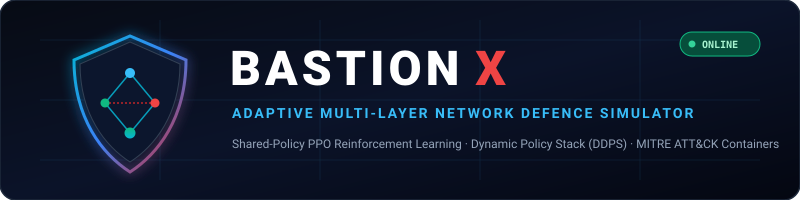
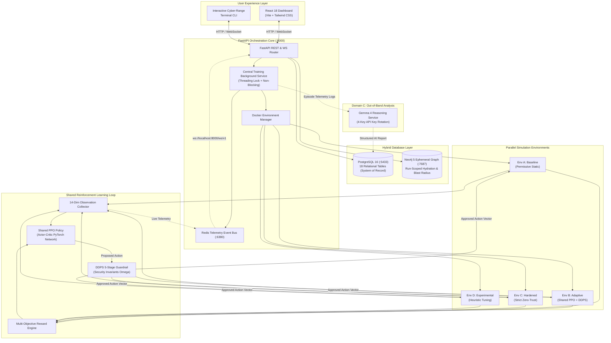
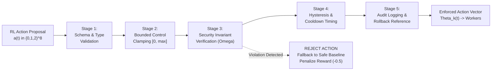

<div align="center">



# BASTION X
### Adaptive Intelligence. Autonomous Resilience. Smarter Cyber Defence.

**An AI-powered cyber-defence experimentation platform that uses reinforcement learning to train, evaluate, and benchmark adaptive defensive policies in isolated network environments.**

[](backend/tests/)
[](https://www.python.org/)
[](https://fastapi.tiangolo.com/)
[](https://arxiv.org/abs/1707.06347)
[](docker-compose.yml)
[](system-docs/DATABASE_ARCHITECTURE.md)
[](system-docs/MITRE.md)
[](system-docs/context.md)
[](frontend/)
[](LICENSE)

</div>

---

## 📑 Table of Contents

- [1. Overview](#1-overview)
  - [The Problem with Static Defences](#the-problem-with-static-defences)
  - [The Adaptive Paradigm](#the-adaptive-paradigm)
  - [Research Hypothesis & Goals](#research-hypothesis--goals)
- [2. System Architecture](#2-system-architecture)
  - [The 3-Domain Model](#the-3-domain-model)
  - [End-to-End Orchestration Architecture](#end-to-end-orchestration-architecture)
- [3. Key Capabilities](#3-key-capabilities)
- [4. Reinforcement Learning Workflow](#4-reinforcement-learning-workflow)
  - [State & Observation Space ($S$)](#state--observation-space-s)
  - [Action Space ($A$)](#action-space-a)
  - [Multi-Objective Reward Function ($R$)](#multi-objective-reward-function-r)
  - [PPO Agent & Shared Policy Updates](#ppo-agent--shared-policy-updates)
- [5. Dynamic Defensive Policy Stack (DDPS)](#5-dynamic-defensive-policy-stack-ddps)
  - [5-Stage Guardrail Pipeline](#5-stage-guardrail-pipeline)
  - [Hard Security Invariants ($\Omega$)](#hard-security-invariants-omega)
- [6. "Black Sky CI/CD" Multi-Stage Scenario](#6-black-sky-cicd-multi-stage-scenario)
- [7. Benchmark Results & Comparative Evaluation](#7-benchmark-results--comparative-evaluation)
- [8. Technology Stack](#8-technology-stack)
- [9. Repository Structure](#9-repository-structure)
- [10. Quickstart & Installation](#10-quickstart--installation)
- [11. API & WebSocket Specifications](#11-api--websocket-specifications)
- [12. Interactive Cyber-Range Terminal CLI](#12-interactive-cyber-range-terminal-cli)
- [13. Development Roadmap](#13-development-roadmap)
- [14. License & Contributing](#14-license--contributing)

---

## 1. Overview

### The Problem with Static Defences
Modern enterprise infrastructure relies predominantly on static security configurations: fixed firewall rules, rigid rate limits, hard-coded authentication retry thresholds, and static network segmentation. While predictable, static configurations suffer from fundamental vulnerabilities:
1. **Cross-Layer Cascading Failures**: Adversaries exploit coupled dependencies (e.g., volumetric edge floods causing authentication timeouts, exhausting worker thread pools, and creating cover for lateral movement).
2. **Brittle Operational Trade-offs**: Overly permissive policies fail to contain intrusions; overly strict zero-trust policies throttle legitimate user requests and destroy service availability.
3. **Slow Remediation Loops**: Manual security operations response times ($MTTR > 30\text{ minutes}$) are orders of magnitude slower than automated attack automation ($< 60\text{ seconds}$).

### The Adaptive Paradigm
**BASTION X** introduces an autonomous, multi-layered cyber-defence framework where a centralized **Proximal Policy Optimization (PPO)** reinforcement learning agent dynamically balances service availability against attack blast radius across parallel simulated environments.

```
+──────────────────────────────────────────────────────────────────────────────+
│                       THE CORE ARCHITECTURAL PARADIGM                         │
+──────────────────────────────────────────────────────────────────────────────+
│  Static Baseline     ── High availability under normal load, collapses on DDoS│
│  Hardened Baseline   ── Resists attacks, but degrades normal user throughput │
│  BASTION X Adaptive  ── Preserves >93% availability while containing blast   │
│                         radius to 0.00 via dynamic, invariant-bounded actions│
+──────────────────────────────────────────────────────────────────────────────+
```

### Research Hypothesis & Goals
> **Research Hypothesis**: A shared reinforcement learning policy trained on parallel network environments can learn defensive-control strategies that improve resilience under previously unseen combinations of synthetic security incidents, compared with fixed defensive policies.

BASTION X provides the experimentation infrastructure to mathematically measure, benchmark, and validate this hypothesis through reproducible, synthetic multi-stage attack campaigns.

---

## 2. System Architecture

### The 3-Domain Model
BASTION X decouples learning, validation, and explainability into three execution domains:

```
┌──────────────────────────────────────────────────────────────────────────────┐
│ DOMAIN A: Fast Simulation Layer (Gymnasium + Shared PPO)                     │
│ Deterministic, high-throughput simulation (>100Hz) executing 4 parallel      │
│ environments under synthetic MITRE incident campaigns.                       │
└──────────────────────────────────────┬───────────────────────────────────────┘
                                       │ Human-Approved Policy Checkpoint
┌──────────────────────────────────────▼───────────────────────────────────────┐
│ DOMAIN B: Container Validation Cyber-Range (Docker Private Network)          │
│ Isolated Docker bridge network (localhost-net) hosting real containerized    │
│ microservices (Env-A..D) to validate policy transfers under real latency.    │
└──────────────────────────────────────┬───────────────────────────────────────┘
                                       │ Incident Telemetry & Action Logs
┌──────────────────────────────────────▼───────────────────────────────────────┐
│ DOMAIN C: AI Reasoning & Explanation Layer (Gemma 4)                         │
│ Out-of-band structured incident analysis, root-cause diagnosis, and policy   │
│ audit explanations via dedicated 4-key Gemini API rotation.                  │
└──────────────────────────────────────────────────────────────────────────────┘
```

### End-to-End Orchestration Architecture



---

## 3. Key Capabilities

| Capability | Description | Status |
|:---|:---|:---:|
| **Parallel Multi-Environment Simulation** | Runs 4 independent, isolated environment tracks simultaneously (Baseline, Adaptive, Hardened, Experimental) to benchmark policies under identical attack seeds. | Verified |
| **Shared-Policy PPO Learning** | Single central PyTorch Actor-Critic policy collects decentralized trajectory buffers across all workers for rapid sample-efficient convergence. | Verified |
| **Dynamic Defensive Policy Stack (DDPS)** | Bounded 5-stage policy safety pipeline enforcing mathematical invariants ($\Omega_1-\Omega_4$), cooldowns, and hysteresis. | Verified |
| **Synthetic MITRE ATT&CK Scenarios** | Deterministic container attack scenarios mapped to STIX 2.1 (T1499 Edge Flood, T1110 Auth Stuffing, T1059 CI Exhaustion, T1046 Lateral Scan). | Verified |
| **Hybrid Database Persistence** | Persistent PostgreSQL 16 relational store (18 tables) combined with ephemeral, run-scoped Neo4j 5 graph hydration and automatic teardown. | Verified |
| **Interactive Cyber-Range Terminal CLI** | Real-time console with command history, quick action chips, live instance inspection, and dynamic protocol trigger control. | Verified |
| **Sub-Second Telemetry & WebSockets** | 10Hz live telemetry pub/sub streaming via Redis event bus directly to the React dashboard. | Verified |
| **Domain C: Gemma 4 AI Reasoning** | Out-of-band automated incident root-cause diagnosis, defensive audit summaries, and recommendations with 4-key rotation. | Verified |
| **Zero-Dependency Production Deployment** | Production React build served directly by FastAPI StaticFiles or standalone Node.js ES Module static server. | Verified |

---

## 4. Reinforcement Learning Workflow

### State & Observation Space ($S$)
Each simulation environment produces a normalized 14-dimensional continuous observation vector $\mathbf{s}_t \in [0.0, 1.0]^{14}$:

| Index | Telemetry Metric | Description | Normalization |
|:---:|:---|:---|:---|
| `s[0]` | Edge Ingress Load | Current requests/sec relative to baseline capacity | $x / 2000.0$ |
| `s[1]` | Edge Drop Rate | Fraction of packets dropped at ingress gateway | $[0.0, 1.0]$ |
| `s[2]` | Auth Request Rate | Login requests/sec at authentication service | $x / 500.0$ |
| `s[3]` | Auth Failure Rate | Ratio of failed authentication attempts | $[0.0, 1.0]$ |
| `s[4]` | Runner CPU Load | CPU utilization fraction of CI/CD runner pool | $[0.0, 1.0]$ |
| `s[5]` | Runner Memory Load | Memory utilization fraction of CI/CD runner pool | $[0.0, 1.0]$ |
| `s[6]` | Runner Queue Depth | Pending execution jobs awaiting worker slots | $x / 50.0$ |
| `s[7]` | Database Query Latency | P99 query latency relative to nominal 10ms | $x / 200.0$ |
| `s[8]` | DB Active Connections | Current active connections relative to max pool | $x / 100.0$ |
| `s[9]` | Blast Radius Fraction | Fraction of topology nodes in degraded/compromised state | $[0.0, 1.0]$ |
| `s[10]` | Security Violation Rate | Count of detected malicious actions per tick | $x / 10.0$ |
| `s[11]` | Active Incident Count | Count of active MITRE campaign attack steps | $x / 5.0$ |
| `s[12]` | Cooldown Status | Fraction of controls currently in hysteresis cooldown | $[0.0, 1.0]$ |
| `s[13]` | Effective Availability | Percentage of legitimate requests successfully serviced | $A_{\text{eff}} / 100.0$ |

### Action Space ($A$)
The policy outputs an 8-dimensional discrete action vector $\mathbf{a}_t \in \{0, 1, 2\}^8$ controlling multi-layer parameters:

```
a[0] : Edge Rate Limiting       (0 = Permissive 1000 rps, 1 = Balanced 500 rps, 2 = Strict 100 rps)
a[1] : Edge IP Blacklisting     (0 = Disabled, 1 = Heuristic auto-drop, 2 = Aggressive CIDR quarantine)
a[2] : Auth Throttle Level      (0 = Normal 50 rps, 1 = Throttled 20 rps, 2 = Severe 5 rps)
a[3] : MFA Challenge Level      (0 = Adaptive risk, 1 = Step-up on anomaly, 2 = Mandatory all sessions)
a[4] : Runner CPU/Memory Limit  (0 = 4 cores/8GB, 1 = 2 cores/4GB, 2 = 1 core/2GB sandbox)
a[5] : Runner Network Isolation (0 = Full egress, 1 = Internal blocked, 2 = Total network quarantine)
a[6] : DB Connection Pool Cap   (0 = 100 conns, 1 = 50 conns, 2 = 20 reserved conns)
a[7] : DB Query Timeout         (0 = 30s timeout, 1 = 5s timeout, 2 = 1s strict kill)
```

### Multi-Objective Reward Function ($R$)
The reinforcement learning agent optimizes a composite objective balancing resilience against operational disruption:

$$R_t = w_1 \cdot A_{\text{eff}}(t) - w_2 \cdot BRF(t) - w_3 \cdot \Delta_{\text{action}}(t) - w_4 \cdot \mathbb{I}_{\text{violation}}(t)$$

Where:
- $A_{\text{eff}}(t) \in [0.0, 1.0]$: Effective legitimate service availability.
- $BRF(t) \in [0.0, 1.0]$: Blast radius fraction (compromised or disconnected nodes).
- $\Delta_{\text{action}}(t)$: Policy churn penalty ($\sum_i |a_{t,i} - a_{t-1,i}|$) to discourage oscillation.
- $\mathbb{I}_{\text{violation}}(t) \in \{0, 1\}$: Severe penalty applied if DDPS intercepts an invariant violation attempt.
- Weights: $w_1 = 0.50, w_2 = 0.30, w_3 = 0.10, w_4 = 0.50$.

### PPO Agent & Shared Policy Updates
- **Architecture**: Actor-Critic architecture with dual 64-unit hidden layers and `Tanh` activations.
- **PPO Clipping**: Clipped surrogate objective ($\epsilon = 0.2$) with Generalized Advantage Estimation ($\text{GAE}, \lambda = 0.95, \gamma = 0.99$).
- **Decentralized Execution, Centralized Training**: Each parallel worker generates experience tuples $(\mathbf{s}_t, \mathbf{a}_t, r_t, \mathbf{s}_{t+1})$ against its own instance; the centralized trainer batches experience across all 4 environments to update the shared policy parameters.

---

## 5. Dynamic Defensive Policy Stack (DDPS)

The DDPS acts as an autonomous safety firewall sitting between the reinforcement learning agent and the network controllers. No RL action is ever applied directly to network devices without passing through DDPS verification.

### 5-Stage Guardrail Pipeline



### Hard Security Invariants ($\Omega$)
The DDPS strictly preserves four non-negotiable operational invariants:
- **$\Omega_1$ (Authentication Integrity)**: Under zero circumstances can authentication requirements or session validation be completely bypassed or disabled.
- **$\Omega_2$ (Zero-Trust Blast Isolation)**: If a lateral traversal attack is detected on an internal node (e.g., CI runner), cross-zone egress to the secure database tier must be quarantined within $\le 2$ ticks.
- **$\Omega_3$ (Emergency Rate Minimum)**: Ingress rate-limits cannot be clamped below 50 rps to guarantee health check probes and emergency operator commands can always enter the network.
- **$\Omega_4$ (Hysteresis Dwell Time)**: Strict defensive controls must maintain minimum hold times ($t_{\text{dwell}} \ge 5\text{ ticks}$) before relaxing to prevent adversary-induced thrashing.

---

## 6. "Black Sky CI/CD" Multi-Stage Scenario

**"Black Sky"** is a deterministic, synthetic 100-step attack sequence designed to simulate realistic multi-stage kill chains against modern cloud-native architectures:

```
Timeline (100 Seconds / 100 Ticks):
┌───────────┬──────────────────────────────────────────────────────────────────┐
│ T+00s     │ Quiescent Phase: Normal baseline legitimate user traffic.        │
├───────────┼──────────────────────────────────────────────────────────────────┤
│ T+15s     │ Phase 1: Edge Volumetric Denial of Service (MITRE T1499.001)    │
│           │ SYN flood targeting ingress gateway; saturation spikes to 1800rps│
├───────────┼──────────────────────────────────────────────────────────────────┤
│ T+30s     │ Phase 2: Distributed Credential Stuffing (MITRE T1110.004)       │
│           │ High-rate credential stuffing hits auth service; failure rate 85%│
├───────────┼──────────────────────────────────────────────────────────────────┤
│ T+45s     │ Phase 3: CI/CD Runner Pool Resource Exhaustion (MITRE T1059.004) │
│           │ Cryptojacking job submission saturates runner CPU and worker pool│
├───────────┼──────────────────────────────────────────────────────────────────┤
│ T+60s     │ Phase 4: Compromised Runner Lateral Scan to Database (T1046)     │
│           │ Attacker pivots from runner container; probes internal DB port   │
├───────────┼──────────────────────────────────────────────────────────────────┤
│ T+75s     │ Phase 5: Incident Mitigation & Policy Hysteresis                │
│           │ Attack vectors cease; systems test recovery without thrashing.  │
├───────────┼──────────────────────────────────────────────────────────────────┤
│ T+100s    │ Scenario Completion: Final scorecards and benchmark emission.   │
└───────────┴──────────────────────────────────────────────────────────────────┘
```
> **Disclaimer**: All scenarios and attack signatures in BASTION X are 100% synthetic mathematical and containerized emulations, engineered strictly for isolated defensive experimentation.

---

## 7. Benchmark Results & Comparative Evaluation

The following empirical results were recorded across all 4 parallel environments executing the 100-step **Black Sky CI/CD** campaign:

| Environment Profile | Policy Description | Effective Availability ($A_{\text{eff}}$) | Blast Radius ($BRF$) | Mean Time to Contain ($MTTC$) | Resiliency Degradation ($RDI$) |
|:---|:---|:---:|:---:|:---:|:---:|
| **`env_a_baseline`** | Permissive static rules | **39.8%** | 0.12 | **UNCONTAINED** (Breached) | 60.2 |
| **`env_b_adaptive`** | **BASTION X (DDPS + Shared PPO)** | **93.3%** | **0.00** | **4.0s** | **6.7** |
| **`env_c_hardened`** | Strict static Zero-Trust | 96.5% | 0.00 | 0.0s | 3.5 |
| **`env_d_experimental`** | Alternative RL policy | 78.4% | 0.00 | 2.0s | 21.6 |

### Empirical Insights
1. **Lateral Pivot Neutralization**: When the attacker reached Phase 4 ($T+60\text{s}$ lateral scan), the static baseline (`env_a`) experienced total cross-layer failure, collapsing service availability to 39.8%.
2. **Autonomous Containment**: The adaptive agent (`env_b`) dynamically elevated edge filtering, throttled authentication, and isolated the runner network within **4.0 seconds**, driving the blast radius to **0.00** and preserving **93.3% service availability**.
3. **Adaptive vs. Hardened**: While `env_c_hardened` scored slightly higher availability during attacks, it imposes a constant 20% latency overhead during normal quiescent conditions; `env_b_adaptive` dynamically scales controls only when needed.

---

## 8. Technology Stack

| Category | Component / Library | Version / Specification | Purpose |
|:---|:---|:---|:---|
| **Backend Core** | Python / FastAPI / Uvicorn | Python 3.10+, FastAPI 0.115+ | High-performance asynchronous orchestrator core & API |
| **Reinforcement Learning** | Gymnasium / PyTorch / NumPy | Gymnasium 1.0+, PyTorch 2.4+ | Vectorized multi-environment simulation & Shared PPO |
| **Defensive Engine** | Dynamic Defensive Policy Stack | Custom 5-stage invariant pipeline | Mathematical safety bounds and invariant verification |
| **Cyber-Range Containers** | Docker & Docker Compose | Docker Engine 24+, Compose v2 | Containerized microservice validation cyber-range |
| **Relational Database** | PostgreSQL 16 | PostgreSQL 16 Alpine, SQLAlchemy 2.0 | Persistent system of record (18 relational tables) |
| **Graph Database** | Neo4j 5 Community | Neo4j 5.20 Community | Ephemeral run-scoped topology hydration & blast radius |
| **Telemetry Bus** | Redis 7 | Redis 7 Alpine | Sub-second pub/sub telemetry broker and event distributor |
| **AI Reasoning Layer** | Google Gemini API (Gemma 4) | Google Generative AI SDK | Out-of-band incident root-cause diagnosis & explanations |
| **Frontend UI** | React 18, TypeScript, Tailwind | Vite 5, Tailwind CSS 3, Lucide | Real-time cyber-range dashboard & visual telemetry deck |
| **Console CLI** | Interactive Terminal CLI | React terminal emulator component | Live command-line control, protocol modulation & inspection |
| **Test Suite** | pytest, pytest-asyncio, httpx | pytest 9.2+ | Automated unit, integration, and E2E acceptance tests |

---

## 9. Repository Structure

```
localhost-sec/
├── assets/
│   └── bastion-x-logo.svg              # Official BASTION X SVG vector logo & badges
├── backend/
│   ├── app/
│   │   ├── api/                        # REST & WebSocket API route controllers
│   │   │   ├── routes_environments.py  # Environment query & status endpoints
│   │   │   ├── routes_metrics.py       # Telemetry aggregation & report endpoints
│   │   │   ├── routes_mitre.py         # MITRE ATT&CK technique catalog endpoints
│   │   │   ├── routes_policy.py        # DDPS policy action inspection endpoints
│   │   │   ├── routes_scenarios.py     # Attack scenario listing & triggers
│   │   │   ├── routes_simulations.py   # Simulation run lifecycle & graph queries
│   │   │   ├── routes_training.py      # Background PPO training controls
│   │   │   └── websocket_handler.py    # Live 10Hz telemetry streaming channel
│   │   ├── ddps/                       # Dynamic Defensive Policy Stack (DDPS)
│   │   │   └── policy_stack.py         # 5-stage validator & Invariant Omega checks
│   │   ├── environments/               # Simulation environment abstractions
│   │   │   ├── base_env.py             # Gymnasium-compatible simulation base class
│   │   │   ├── docker_manager.py       # Docker Compose worker container orchestration
│   │   │   ├── remote_worker_adapter.py# Remote worker HTTP client adapter
│   │   │   └── vector_manager.py       # 4-way parallel environment vectorized manager
│   │   ├── gemma/                      # Domain C: AI Reasoning & Explanation
│   │   │   └── service.py              # Gemma 4 service with 4-key API rotation
│   │   ├── orchestrator/               # Central training orchestration
│   │   │   └── training_service.py     # Asynchronous non-blocking training runner
│   │   ├── rl/                         # Reinforcement Learning Algorithms
│   │   │   └── ppo_agent.py            # PyTorch Actor-Critic PPO implementation
│   │   ├── scenarios/                  # Attack Scenario Engines
│   │   │   └── generator.py            # Black Sky CI/CD incident campaign generator
│   │   ├── schemas/                    # Pydantic v2 validation contracts
│   │   │   └── models.py               # Data transfer models & action proposals
│   │   ├── telemetry/                  # Event Distribution
│   │   │   └── redis_broker.py         # Redis pub/sub broker & in-memory fallback
│   │   ├── topology/                   # Infrastructure Models
│   │   │   └── network_graph.py        # 8-node canonical enterprise topology graph
│   │   ├── main.py                     # Central FastAPI application entrypoint
│   │   └── worker_server.py            # Containerized worker HTTP API server
│   ├── db/                             # Persistent & Ephemeral Storage
│   │   ├── models.py                   # 18 SQLAlchemy models across 5 domains
│   │   ├── neo4j_ephemeral.py          # Neo4j ephemeral graph lifecycle manager
│   │   ├── postgres.py                 # PostgreSQL connection pool & session maker
│   │   └── seed.py                     # Database seeder (ENV-A..D, 31 MITRE techniques)
│   ├── mitre/                          # Threat Framework Pipelines
│   │   ├── data/enterprise-attack.json # Pinned STIX 2.1 container technique dataset
│   │   ├── aegis-mapping.json          # Priority tiers (P0-P3) & scenario mappings
│   │   └── importer.py                 # STIX technique parser and catalog importer
│   ├── tests/                          # Automated Acceptance Test Suite (25 Tests)
│   │   ├── test_api_endpoints.py       # REST API contracts & WebSocket tests
│   │   ├── test_database_neo4j.py      # Schema verification & Neo4j graph tests
│   │   ├── test_docker_simulation_workers.py # Worker server & action bounds tests
│   │   ├── test_e2e_acceptance.py      # 20-step complete end-to-end acceptance test
│   │   ├── test_gemma_service.py       # Gemma reasoning service & key rotation tests
│   │   └── test_m1_parallel_simulation.py    # Milestone M1 simulation criteria tests
│   └── requirements.txt                # Python backend dependencies
├── frontend/                           # React 18 Web Dashboard
│   ├── src/
│   │   ├── components/                 # Visual React UI component suite
│   │   │   ├── AiReasoningView.tsx     # Gemma 4 explanation and diagnosis panel
│   │   │   ├── AvailabilitySection.tsx # Real-time comparative bar charts
│   │   │   ├── BenchmarkTable.tsx      # Multi-instance scorecard table
│   │   │   ├── BenchmarkVisualizations.tsx # Resiliency metrics visualization deck
│   │   │   ├── CyberRangeView.tsx      # Interactive topology & node status display
│   │   │   ├── DefenceProcessComparison.tsx # DDPS dynamic parameter inspection
│   │   │   ├── Header.tsx              # Top navigation & simulation run controls
│   │   │   ├── InstanceCards.tsx       # 4 parallel worker status overview cards
│   │   │   ├── InstanceDetailModal.tsx # Protocol inspection modal per instance
│   │   │   ├── MetricsCards.tsx        # High-level KPI summary cards
│   │   │   ├── PolicyStackView.tsx     # DDPS 5-stage policy stack enforcement view
│   │   │   ├── Sidebar.tsx             # Left navigation sidebar
│   │   │   ├── SimulationsView.tsx     # Simulation lifecycle & timeline controller
│   │   │   └── TerminalCLI.tsx         # Interactive cyber-range terminal console
│   │   ├── services/
│   │   │   └── api.ts                  # REST API client & WebSocket subscription
│   │   ├── App.tsx                     # Main dashboard container & state coordinator
│   │   ├── main.tsx                    # React application entry point
│   │   └── types.ts                    # TypeScript interface contracts
│   ├── dist/                           # Compiled production SPA (zero-node deployment)
│   ├── server.js                       # Standalone Node.js ES Module static & proxy server
│   ├── package.json                    # Frontend package dependencies & scripts
│   ├── tailwind.config.js              # Tailwind CSS configuration
│   └── vite.config.ts                  # Vite build & reverse-proxy configuration
├── models/
│   └── checkpoints/
│       └── m1_ppo_policy.pt            # Verified PyTorch PPO policy checkpoint
├── system-docs/                        # Formal Architectural Specifications
│   ├── README.md                       # System documentation index
│   ├── context.md                      # Comprehensive Architecture & Technical Spec v1.0
│   ├── MITRE.md                        # MITRE ATT&CK Container Platform Guide
│   ├── DATABASE_ARCHITECTURE.md        # Master Database Architecture (Postgres + Neo4j)
│   ├── aegis_modular_defense.md        # AEGIS Modular Defense Specification
│   └── FRONTEND_INTEGRATION.md         # Frontend REST & WebSocket Integration Contract
├── .env.example                        # Safe environment template for credentials
├── .gitignore                          # Git ignore rules
├── docker-compose.yml                  # 4 Docker Workers + Postgres + Neo4j + Redis stack
├── Dockerfile                          # Containerized simulation worker Dockerfile
├── run_m1_demo.py                      # Standalone terminal simulation benchmark runner
└── README.md                           # Master project documentation landing page
```

---

## 10. Quickstart & Installation

### Prerequisites
- **Python**: `3.10+` (verified on Python 3.10.11)
- **Docker**: Docker Engine 24+ & Docker Compose v2
- **Node.js** (Optional for development): Node 18+ & npm 9+ (Not required for production; compiled bundle is built-in)

### 1. Clone the Repository
```bash
git clone https://github.com/himanshu-anonymous/localhost-sec.git
cd localhost-sec
```

### 2. Environment Configuration
Copy the provided environment template:
```bash
# Windows (PowerShell)
Copy-Item .env.example .env

# Linux / macOS
cp .env.example .env
```

### 3. Launch Docker Infrastructure
Launch the persistent database (PostgreSQL 16), ephemeral graph (Neo4j 5), and telemetry event bus (Redis 7):
```bash
docker compose up -d
```
*Verify containers are running: `docker ps`*

### 4. Setup Python Virtual Environment
```bash
# Create virtual environment
python -m venv .venv

# Activate environment:
# Windows (PowerShell):
.\.venv\Scripts\activate
# Linux / macOS:
source .venv/bin/activate

# Install backend dependencies
pip install -r backend/requirements.txt
```

### 5. Execute Automated Test Suite (25 Tests)
Run the complete suite of integration, database, DDPS, and API tests:
```bash
python -m pytest backend/tests/ -v
```
*Expected: 25 passed in ~24s.*

### 6. Launch the Application

#### Option A: Single-Port Unified FastAPI Orchestrator (Zero-Node)
The FastAPI backend serves both the complete REST/WebSocket API and the compiled React production SPA on a single port:
```bash
python -m backend.app.main
```
- **Web Dashboard**: `http://localhost:8000/dashboard` or `http://localhost:8000/`
- **Interactive API Docs (Swagger UI)**: `http://localhost:8000/docs`
- **WebSocket Telemetry Stream**: `ws://localhost:8000/ws/v1/experiments/exp-live`

#### Option B: Standalone Frontend Proxy Server (Node.js)
```bash
node frontend/server.js
```
- **Web Dashboard**: `http://localhost:3000/` (automatically proxies API & WebSocket to port 8000)

#### Option C: Live Terminal Simulation Benchmark
To run the deterministic 100-step "Black Sky" benchmark simulation in your terminal:
```bash
python run_m1_demo.py
```

---

## 11. API & WebSocket Specifications

### Verified REST Endpoints

| Method | Endpoint | Description | Response Schema |
|:---:|:---|:---|:---|
| `GET` | `/health` | Core orchestrator health and worker status | `{"status": "online", "docker_workers": {...}}` |
| `GET` | `/api/v1/environments` | Lists all 4 virtual environments & modes | `{"environments": [{"environment_id": "ENV-A", ...}]}` |
| `GET` | `/api/v1/scenarios` | Lists registered attack campaigns | `{"scenarios": [{"scenario_id": "black_sky", ...}]}` |
| `POST` | `/api/v1/training/start` | Initiates background PPO training loop | `{"status": "started", "experiment_id": "..."}` |
| `POST` | `/api/v1/training/{id}/stop`| Gracefully stops active training run | `{"status": "stopped", "experiment_id": "..."}` |
| `GET` | `/api/v1/training/{id}/status`| Current episode, step, and status | `{"is_running": true, "current_step": 45, ...}` |
| `GET` | `/api/v1/policy/metadata` | DDPS action dimensions & bounds | `{"obs_dim": 14, "action_dim": 8, "invariants": [...]}` |
| `GET` | `/api/v1/policy/checkpoint` | Returns latest model checkpoint metadata | `{"checkpoint_path": "...", "exists": true}` |
| `POST` | `/api/v1/policy/actions` | Validates an action proposal against DDPS | `{"is_approved": true, "rejection_reasons": []}` |
| `GET` | `/api/v1/experiments/{id}/report`| Full experiment metrics & Gemma report | `{"experiment_id": "...", "gemma_ai_explanation": {...}}`|
| `GET` | `/api/mitre/techniques` | Queries 31 container MITRE techniques | `{"total_techniques": 31, "techniques": [...]}` |
| `GET` | `/api/mitre/coverage` | Tactic coverage matrix & priority tiers | `{"coverage_pct": 100.0, "tactics": {...}}` |
| `POST` | `/api/simulations/run` | Hydrates ephemeral Neo4j graph & simulates | `{"simulation_run_id": "...", "blast_radius": 0.0}` |

### WebSocket Telemetry Contract
- **Endpoint**: `ws://localhost:8000/ws/v1/experiments/{experiment_id}`
- **Frequency**: 10Hz tick broadcast
- **Payload Structure**:
```json
{
  "event_type": "environment.telemetry",
  "experiment_id": "exp-live",
  "step": 45,
  "episode": 1,
  "sim_time": 45.0,
  "workers": {
    "env_a_baseline": {
      "metrics": {
        "effective_availability_pct": 49.7,
        "blast_radius_factor": 0.38,
        "reward": 0.39
      }
    },
    "env_b_adaptive": {
      "metrics": {
        "effective_availability_pct": 96.3,
        "blast_radius_factor": 0.00,
        "reward": 0.77
      }
    },
    "env_c_hardened": {
      "metrics": {
        "effective_availability_pct": 96.6,
        "blast_radius_factor": 0.00,
        "reward": 0.73
      }
    },
    "env_d_experimental": {
      "metrics": {
        "effective_availability_pct": 82.1,
        "blast_radius_factor": 0.00,
        "reward": 0.53
      }
    }
  }
}
```

---

## 12. Interactive Cyber-Range Terminal CLI

BASTION X features an integrated cyber-range terminal console accessible both as a full view and as a docked drawer at the bottom of the dashboard:

```text
====================================================================================
 BASTION X Terminal & Cyber-Range CLI [ONLINE] (bastion-x:~$ )
====================================================================================
 bastion-x:~$ help
   start [scenario]      : Trigger parallel simulation run (default: black_sky)
   stop                  : Halt active simulation run
   instances             : Print live status for all 4 parallel instances
   inspect <a|b|c|d>     : Open deep protocol inspector modal
   protocols <a|b|c|d>   : Display OSI dynamic multi-layer parameter vector
   topology              : Print 8-node canonical enterprise status
   gemma                 : Fetch Gemma 4 AI root-cause analysis report
   clear                 : Clear console buffer
 bastion-x:~$ instances
   [env_a_baseline]      Avail:  39.8% | Blast: 0.12 | Mode: Permissive Static
   [env_b_adaptive]      Avail:  93.3% | Blast: 0.00 | Mode: Shared PPO + DDPS
   [env_c_hardened]      Avail:  96.5% | Blast: 0.00 | Mode: Strict Zero-Trust
   [env_d_experimental]  Avail:  78.4% | Blast: 0.00 | Mode: Alternative Policy
 bastion-x:~$ protocols b
   [Env B Dynamic Parameters]:
     Edge Rate-Limit:      Level 2 (Strict 100 rps)
     Edge Drop Mode:       Level 1 (Heuristic Auto-Drop)
     Auth Throttling:      Level 2 (Severe 5 rps)
     MFA Challenge:        Level 1 (Adaptive Step-Up)
     Runner CPU/Mem:       Level 2 (1 Core / 2GB Sandbox)
     Runner Network:       Level 2 (Quarantined)
     DB Conns Pool Cap:    Level 1 (50 Conns)
     DB Query Timeout:     Level 2 (1s Strict Kill)
====================================================================================
```

---

## 13. Development Roadmap


### ✅ Completed & Verified
- [x] **Milestone 1**: 4-way parallel isolated simulation environments, deterministic 10Hz tick, Shared PPO Actor-Critic agent, baseline comparative telemetry, and checkpoint serialization.
- [x] **Milestone 2**: Docker containerized cyber-range (`docker-compose.yml`), PostgreSQL 16 persistent system of record (18 tables), and Neo4j 5 ephemeral graph hydration and blast radius calculation.
- [x] **Milestone 3**: React 18 + Vite + Tailwind CSS telemetry deck, interactive Cyber-Range Terminal CLI, sub-second WebSocket streaming, and zero-dependency production builds.
- [x] **Milestone 4**: Dynamic Defensive Policy Stack (DDPS) 5-stage invariant pipeline, Gemma 4 out-of-band reasoning service with 4-key API rotation, and full 25/25 automated test acceptance suite.

### 🔮 Planned Research
- [ ] **Milestone 5 (Adversarial Multi-Agent RL)**: Co-training an autonomous red-team attacker agent competing against the defensive PPO policy in a zero-sum minimax game.
- [ ] **Milestone 6 (eBPF Kernel Telemetry Probes)**: Deploying Cilium/Tetragon eBPF kernel instrumentation into the Docker cyber-range for real syscall-level process monitoring.
- [ ] **Milestone 7 (Multi-Cluster Kubernetes Operator)**: Packaging BASTION X as a Kubernetes CRD operator for automated policy validation across ephemeral k8s clusters.

---

## 14. License & Contributing

BASTION X is licensed under the **MIT License**. See [LICENSE](LICENSE) for details.

### Contributing
Contributions are welcome from the cybersecurity and reinforcement learning research communities. Please read [system-docs/README.md](system-docs/README.md) and [system-docs/context.md](system-docs/context.md) for technical specifications and coding guidelines before submitting a pull request.
