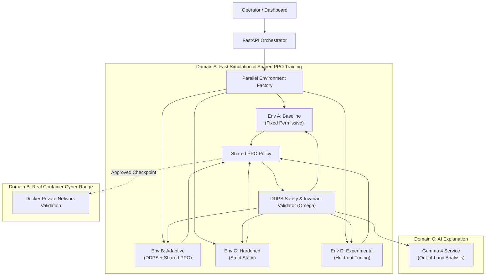

# localhost (BASTION X)
### Adaptive Multi-Layer Network Defence Simulator

[](https://www.python.org/downloads/)
[](https://arxiv.org/abs/1707.06347)
[](#dynamic-defensive-policy-stack-ddps)
[](LICENSE)

An open-source, AI-assisted cyber-resilience experimentation platform that trains, evaluates, and benchmarks adaptive defensive policies across multiple isolated private network environments under concurrent, multi-stage attack scenarios.

---

## ⚡ The Core Problem & Innovation

Current cyber testing frameworks evaluate defensive controls (firewalls, WAFs, rate-limiters, IAM) in isolation. In reality, modern attacks exploit **cross-layer cascade failures** (e.g. volumetric edge saturation causing authentication timeouts, leading to thread starvation, and creating cover for lateral movement).

**localhost** introduces:
1. **The 3-Domain Architecture**:
   - **Domain A (Fast Simulation)**: Rapid deterministic Gymnasium-compatible RL training ($>100\text{Hz}$) with shared-policy PPO.
   - **Domain B (Container Cyber-Range)**: Isolated Docker private network validation for human-approved policy checkpoints.
   - **Domain C (AI Reasoning)**: Out-of-band Gemma 4 structured explanations and root-cause analysis.
2. **Dynamic Defensive Policy Stack (DDPS)**: An autonomous safety pipeline that adjusts multi-layer control priorities in real time without ever violating non-negotiable security invariants ($\Omega$).
3. **Synchronous 4-Way Parallel Benchmarking**: Tests Baseline (fixed permissive), Adaptive (DDPS active), Hardened (strict static), and Experimental policies simultaneously under identical attack seeds.



---

## 🚀 Quickstart & Milestone M1 Demo

### 1. Prerequisites & Virtual Environment
```bash
# Clone the repository
git clone https://github.com/himanshu-anonymous/localhost-sec.git
cd localhost-sec

# Create and activate virtual environment
python -m venv .venv
# Windows:
.venv\Scripts\activate
# Linux/macOS:
source .venv/bin/activate

# Install dependencies
pip install -r backend/requirements.txt
```

### 2. Run the Acceptance Tests
Verify all 7 acceptance criteria of Milestone M1 (Parallel RL Simulation Proof):
```bash
python -m pytest backend/tests/test_m1_parallel_simulation.py -v
```

### 3. Run the Live "Black Sky" Simulation Demonstration
```bash
python run_m1_demo.py
```

---

## 📊 Live Benchmark Results ("Black Sky CI/CD" Scenario)

| Environment Profile | Effective Availability | Blast Radius | Containment Time (MTTC) | Resiliency Degradation Index (RDI) |
| :--- | :---: | :---: | :---: | :---: |
| **`env_a_baseline`** (Permissive static) | **39.8%** | 0.12 | **UNCONTAINED** (Breach) | 60.2 |
| **`env_b_adaptive`** (DDPS + PPO) | **93.8%** | **0.00** | **4.0s** | **6.1** |
| **`env_c_hardened`** (Strict static) | 96.5% | 0.00 | 0.0s | 3.5 |
| **`env_d_experimental`** (AI tuning) | 79.1% | 0.12 | 0.0s | 20.9 |

> **Key Finding**: When subjected to simultaneous Edge DDoS, Auth Stuffing, and Lateral CI exploitation, the **Adaptive policy (`env_b`)** contained the lateral pivot in 4 seconds and maintained **93.8% service availability**, whereas the conventional static baseline collapsed to **39.8%**.

---

## 📁 Repository Structure

```
localhost-sec/
├── README.md                           # Main Project Overview & Quickstart
├── .gitignore                          # Ignored caches, environments, & models
├── run_m1_demo.py                      # Live terminal demonstration runner
├── system-docs/                        # 📚 System Architecture & Specifications
│   ├── README.md                       # Documentation Index
│   └── context.md                      # Comprehensive Architecture & Technical Spec v1.0
├── backend/
│   ├── requirements.txt                # Python dependencies (Torch, Gymnasium, FastAPI)
│   ├── app/
│   │   ├── schemas/                    # Pydantic telemetry & action schemas
│   │   ├── topology/                   # 8-node logical enterprise graph
│   │   ├── scenarios/                  # MITRE ATT&CK incident generator (Black Sky)
│   │   ├── ddps/                       # Dynamic Defensive Policy Stack & Invariants (Omega)
│   │   ├── environments/               # Gymnasium environment & parallel vectorizer
│   │   └── rl/                         # Shared PPO agent (PyTorch actor-critic)
│   └── tests/
│       └── test_m1_parallel_simulation.py  # Automated Milestone M1 acceptance tests
└── models/
    └── checkpoints/                    # Saved PyTorch policy checkpoints
```

---

## 📖 System Documentation

Detailed technical documentation, mathematical models, MITRE ATT&CK mapping, and system designs are maintained in the [`system-docs/`](system-docs/) folder:

- [**System Specification & Context (`system-docs/context.md`)**](system-docs/context.md): Full technical specification v1.0, mathematical state formulations, DDPS finite state machine, and roadmap.
- [**Documentation Index (`system-docs/README.md`)**](system-docs/README.md): Guide to system documentation conventions.
