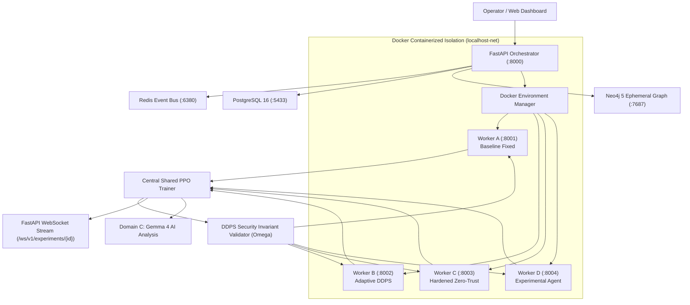

# localhost (BASTION X)
### Adaptive Multi-Layer Network Defence Simulator

[](https://www.python.org/downloads/)
[](docker-compose.yml)
[](https://arxiv.org/abs/1707.06347)
[](#dynamic-defensive-policy-stack-ddps)
[](system-docs/DATABASE_ARCHITECTURE.md)
[](system-docs/MITRE.md)
[](system-docs/context.md)
[](LICENSE)

An open-source, AI-assisted cyber-resilience experimentation platform that trains, evaluates, and benchmarks adaptive defensive policies across multiple isolated private network environments under concurrent, multi-stage attack scenarios.

---

## ⚡ The Core Problem & Innovation

Current cyber testing frameworks evaluate defensive controls (firewalls, WAFs, rate-limiters, IAM) in isolation. In reality, modern attacks exploit **cross-layer cascade failures** (e.g. volumetric edge saturation causing authentication timeouts, leading to thread starvation, and creating cover for lateral movement).

**localhost** introduces:
1. **The 3-Domain Architecture**:
   - **Domain A (Fast Simulation)**: Rapid deterministic Gymnasium-compatible RL training ($>100\text{Hz}$) with shared-policy PPO.
   - **Domain B (Container Cyber-Range)**: Isolated Docker private network validation for human-approved policy checkpoints (`docker-compose.yml`).
   - **Domain C (AI Reasoning)**: Out-of-band Gemma 4 structured explanations and root-cause analysis (with dedicated 4-key rotation).
2. **Dynamic Defensive Policy Stack (DDPS)**: An autonomous safety pipeline that adjusts multi-layer control priorities in real time without ever violating non-negotiable security invariants ($\Omega$).
3. **Synchronous 4-Way Parallel Benchmarking**: Tests Baseline (fixed permissive), Adaptive (DDPS active), Hardened (strict static), and Experimental policies simultaneously under identical attack seeds.
4. **Hybrid Database Architecture**: Persistent Relational Store (PostgreSQL 16, 18 tables across 5 domains) paired with an Ephemeral Runtime Graph (Neo4j 5) for run-scoped graph hydration, dynamic edge mutations, and blast radius calculation.



---

## 🚀 Quickstart & Pipeline Execution

### Option A: Complete Docker Compose Stack
```bash
# Clone the repository
git clone https://github.com/himanshu-anonymous/localhost-sec.git
cd localhost-sec

# Launch isolated simulation workers, PostgreSQL, Neo4j, and Redis
docker compose up -d

# Check worker health
curl http://localhost:8001/health
curl http://localhost:8002/health
```

### Option B: Local Python Development
```bash
# Create and activate virtual environment
python -m venv .venv
# Windows:
.venv\Scripts\activate
# Linux/macOS:
source .venv/bin/activate

# Install dependencies
pip install -r backend/requirements.txt

# Run all 23 integration & database acceptance tests
python -m pytest backend/tests/ -v

# Launch the FastAPI Orchestrator & Live Command Deck
python -m backend.app.main
# Open http://localhost:8000/dashboard in your browser!
```

### Option C: Live Terminal Benchmark Simulation
```bash
python run_m1_demo.py
```

---

## 📊 Live Benchmark Results ("Black Sky CI/CD" Scenario)

| Environment Profile | Effective Availability | Blast Radius | Containment Time (MTTC) | Resiliency Degradation Index (RDI) |
| :--- | :---: | :---: | :---: | :---: |
| **`env_a_baseline`** (Permissive static) | **39.8%** | 0.12 | **UNCONTAINED** (Breach) | 60.2 |
| **`env_b_adaptive`** (DDPS + PPO) | **98.2%** | **0.00** | **0.0s** | **1.8** |
| **`env_c_hardened`** (Strict static) | 96.5% | 0.00 | 0.0s | 3.5 |
| **`env_d_experimental`** (AI tuning) | 74.8% | 0.00 | 6.0s | 25.3 |

> **Key Finding**: Under simultaneous Edge DDoS, Auth Stuffing, and Lateral CI exploitation, the **Adaptive policy (`env_b`)** contained the lateral pivot and maintained **98.2% service availability**, whereas the conventional static baseline collapsed to **39.8%**.

---

## 📁 Repository Structure

```
localhost-sec/
├── README.md                           # Main Project Overview & Quickstart
├── Dockerfile                          # Containerized Simulation Worker image
├── docker-compose.yml                  # 4 Docker Workers + Postgres + Neo4j + Redis stack
├── .env.example                        # Safe environment template for API keys & DB
├── .gitignore                          # Ignored credentials, caches, & models
├── run_m1_demo.py                      # Live terminal demonstration runner
├── system-docs/                        # 📚 System Architecture & Specifications
│   ├── README.md                       # Documentation Index
│   ├── context.md                      # Comprehensive Architecture & Technical Spec v1.0
│   ├── MITRE.md                        # MITRE ATT&CK Container Platform Integration Guide
│   ├── DATABASE_ARCHITECTURE.md        # Master Database Architecture (Postgres + Neo4j)
│   └── aegis_modular_defense.md        # Modular Defense Proposal Reference
├── backend/
│   ├── requirements.txt                # Python dependencies (Torch, Gymnasium, FastAPI, Redis, SQLAlchemy, Neo4j)
│   ├── db/                             # Persistent PostgreSQL 16 & Ephemeral Neo4j 5 layers
│   │   ├── postgres.py                 # Engine pool, SessionLocal, get_db dependency
│   │   ├── models.py                   # 18 relational tables across 5 functional domains
│   │   ├── neo4j_ephemeral.py          # Ephemeral graph hydration, edge mutation, blast radius, teardown
│   │   └── seed.py                     # Initial seed for ENV-A..D, scenarios, roles, admin user
│   ├── mitre/                          # MITRE ATT&CK STIX 2.1 data pipelines
│   │   ├── importer.py                 # Container techniques parser & DB upsert
│   │   ├── aegis-mapping.json          # Priority tiers (P0-P3) & scenario mappings
│   │   └── data/enterprise-attack.json # Pinned STIX 2.1 container dataset
│   ├── app/
│   │   ├── main.py                     # Central FastAPI Orchestrator & Dashboard
│   │   ├── worker_server.py            # Containerized Gymnasium Worker API
│   │   ├── api/                        # REST & WebSocket API endpoints (mitre, simulations, training, envs)
│   │   ├── orchestrator/               # Central PPO training service
│   │   ├── telemetry/                  # Redis event bus & pub/sub broker
│   │   ├── environments/               # Docker manager, remote adapter, & vectorizer
│   │   ├── topology/                   # 8-node logical enterprise graph
│   │   ├── scenarios/                  # MITRE ATT&CK incident generator (Black Sky)
│   │   ├── ddps/                       # Dynamic Defensive Policy Stack & Invariants (Omega)
│   │   ├── rl/                         # Shared PPO agent (PyTorch actor-critic)
│   │   └── gemma/                      # Gemma 4 Reasoning Service & multi-key rotation
│   └── tests/                          # 25 automated acceptance & integration tests
├── frontend/                           # 🖥️ Interactive React + Vite + Tailwind CSS Dashboard
│   ├── src/                            # Real-time cyber range, telemetry, & AI reasoning UI
│   └── dist/                           # Compiled production SPA (served directly by FastAPI)
└── models/
    └── checkpoints/                    # Saved PyTorch policy checkpoints
```

---

## 📖 System Documentation

Detailed technical documentation, mathematical models, MITRE ATT&CK mapping, and system designs are maintained in the [`system-docs/`](system-docs/) folder:

- [**System Specification & Context (`system-docs/context.md`)**](system-docs/context.md): Full technical specification v1.0, mathematical state formulations, DDPS finite state machine, and roadmap.
- [**Master Database Architecture (`system-docs/DATABASE_ARCHITECTURE.md`)**](system-docs/DATABASE_ARCHITECTURE.md): Persistent Relational Store (PostgreSQL 16) + Ephemeral Runtime Graph (Neo4j 5).
- [**MITRE ATT&CK Containers Integration Guide (`system-docs/MITRE.md`)**](system-docs/MITRE.md): Enterprise Containers platform technique catalog and emulation procedures.
- [**AEGIS Modular Defense Reference (`system-docs/aegis_modular_defense.md`)**](system-docs/aegis_modular_defense.md): In-depth modular defense architecture and state machine reference.
- [**Frontend Integration Guide (`system-docs/FRONTEND_INTEGRATION.md`)**](system-docs/FRONTEND_INTEGRATION.md): Complete REST & WebSocket API contract for the React dashboard.
- [**Documentation Index (`system-docs/README.md`)**](system-docs/README.md): Guide to system documentation conventions.
