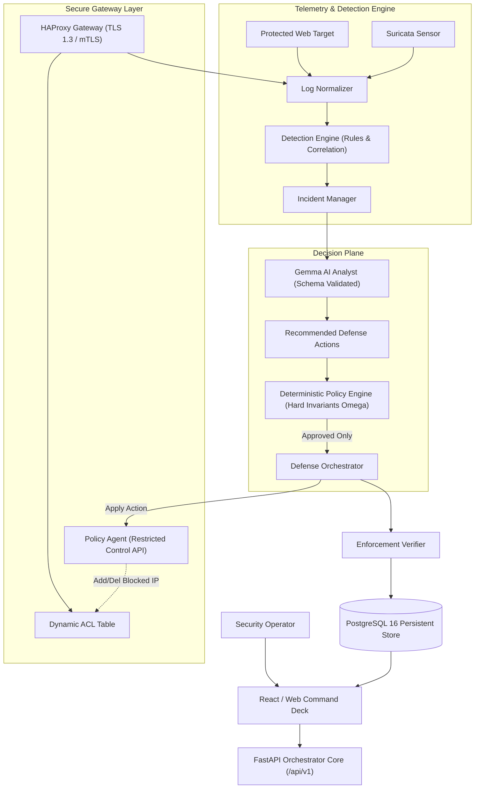

# AEGIS System Architecture Specification

## 1. Architectural Philosophy

AEGIS (Adaptive Elastic Guard & Intelligent Security) is designed around strict separation of responsibilities:
- **Simulation** generates observable behavior in an isolated environment.
- **Telemetry** records and normalizes observable events.
- **Detection** independently identifies suspicious patterns without ground truth contamination.
- **Gemma AI** explains incidents, assesses MITRE techniques, and recommends modular configurations.
- **Policy Engine** deterministically authorizes actions against hard security invariants ($\Omega$).
- **Defense Orchestrator** applies approved policies to the gateway and security controls.
- **Verification Engine** proves the enforcement outcome.
- **PostgreSQL** persists evidence, telemetry, and action audit records.
- **Dashboard** visualizes timelines and compares static vs. adaptive defense.

## 2. Network Topology & Isolation

AEGIS separates runtime services across 5 non-overlapping private subnets:
1. `aegis_frontend` (`172.31.1.0/24`): UI and API communication.
2. `aegis_control` (`172.31.2.0/24`): Control plane connecting FastAPI backend, Policy Agent, PostgreSQL, and Redis.
3. `aegis_access` (`172.31.10.0/24`): Ingress test network connecting the Attacker client, Gateway external interface, and Suricata sensor.
4. `aegis_target` (`172.31.20.0/24`): Protected internal network (`internal: true`) connecting Gateway backend interface and Target Web service. Attacker has no direct route.
5. `aegis_observability` (`172.31.3.0/24`): Telemetry, metrics, and log pipelines.

