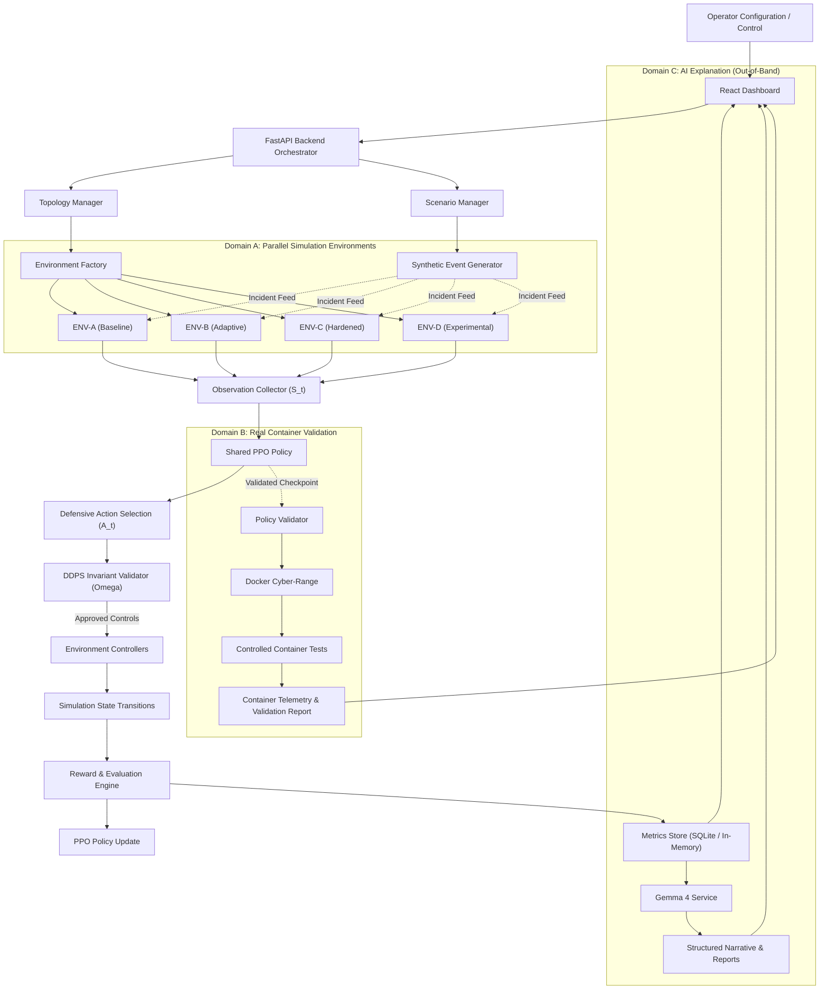
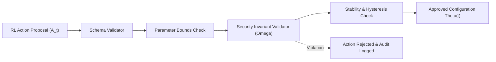

# localhost (BASTION X)
## Adaptive Multi-Layer Network Defence Simulator
### Formal Architecture & Technical Specification — v1.0

**Project Classification:** Open-source, AI-assisted cyber-resilience experimentation platform  
**Project Name:** `localhost` (Internal Codename: `BASTION X`)  
**Primary AI Model:** Gemma 4 (open-weight reasoning, explanation, and analysis layer)  
**Learning Approach:** Shared-policy Reinforcement Learning  
**RL Algorithm:** Proximal Policy Optimization (PPO)  
**Network Architecture:** Hybrid deterministic simulation + containerized cyber-range (3 Execution Domains)  
**Defensive Adaptation:** Dynamic Defensive Policy Stack (DDPS) with Hard Security Invariants  
**Frontend:** React, TypeScript, Tailwind CSS, React Flow  
**Backend:** Python 3.10+, FastAPI, Gymnasium, Stable-Baselines3  
**Initial Deployment:** Local workstation / isolated development environment  

---

# 1. Executive Summary

**localhost** is an open-source reinforcement-learning-based cyber-defence experimentation platform designed to train, evaluate, and compare adaptive defensive policies across multiple isolated private-network environments.

The platform creates multiple virtual representations of a private network and executes controlled, synthetic, multi-stage security scenarios against them. Each environment generates telemetry representing network health, service availability, resource pressure, authentication behaviour, and security events.

A shared reinforcement learning agent learns from these parallel environments and improves its defensive decisions over successive training episodes.

The agent interacts with a **Dynamic Defensive Policy Stack (DDPS)**, which translates its bounded actions into defensive-control adjustments at different network boundaries while strictly enforcing mandatory security invariants.

```
+──────────────────────────────────────────────────────────────────────────────+
│                           CORE ARCHITECTURAL SEPARATION                       │
+──────────────────────────────────────────────────────────────────────────────+
│  Domain A: Fast Simulation Layer       ── Rapid deterministic RL training     │
│  Domain B: Container Validation Layer  ── Docker cyber-range for checkpoints  │
│  Domain C: AI Reasoning Layer          ── Gemma 4 out-of-band analysis        │
+──────────────────────────────────────────────────────────────────────────────+
```

The platform combines:
1. Parallel private-network simulation.
2. MITRE ATT&CK-inspired synthetic incident generation.
3. Shared-policy reinforcement learning (PPO).
4. Dynamic defensive-control modulation (DDPS).
5. Containerized network validation (Docker cyber-range).
6. Gemma 4-based security analysis and explanation.
7. Quantitative resilience benchmarking.
8. Real-time visualization and training monitoring.

The primary objective is to discover defensive policies that maintain service availability, contain simulated incidents, minimize operational disruption, and preserve mandatory security invariants.

### 1.1 Core Proposition
> **Train one shared defensive intelligence across multiple isolated private-network environments, expose it to diverse concurrent security scenarios, and evaluate whether its learned policies improve network resilience compared with conventional static defensive configurations.**

### 1.2 Research Hypothesis
A shared reinforcement learning policy trained on diverse parallel network environments can learn defensive-control strategies that improve resilience under previously unseen combinations of synthetic security incidents, compared with fixed defensive policies.

This is an experimental hypothesis. `localhost` measures and validates it empirically rather than assuming it is true.

---

# 2. Scope and System Boundaries

### 2.1 Included Capabilities
- Creation of configurable private-network topologies.
- Parallel execution of isolated simulation environments.
- Synthetic security incident generation.
- MITRE ATT&CK tactic and technique mapping.
- Centralized shared-policy RL training.
- State observation and defensive action selection.
- Dynamic adjustment of defensive controls.
- Security invariant enforcement ($\Omega$).
- Policy evaluation and benchmarking.
- Container-based validation of selected controls.
- Gemma 4-based incident and policy explanations.
- Live dashboard visualization.
- Reproducible training and evaluation experiments.

### 2.2 Explicit Non-Goals
`localhost` is not intended to:
- Attack public networks or third-party infrastructure.
- Perform real credential stuffing, exploitation, or denial-of-service attacks.
- Execute unrestricted offensive security tools.
- Allow an AI model to directly execute arbitrary commands.
- Automatically weaken authentication or authorization requirements.
- Modify the fundamental OSI protocol architecture.
- Claim that simulation results prove real-world security.
- Treat model-generated recommendations as verified security decisions.

All attack-like behaviour is represented through controlled synthetic events or authorized, isolated validation tests.

---

# 3. System Architecture & Domain Separation

## 3.1 Logical Architecture



## 3.2 Architectural Separation (The Three Domains)

The system enforces three distinct execution domains:

*   **Domain A — Fast Simulation and Training:** Responsible for rapid, deterministic state transitions and parallel RL experience generation. Runs at high frequency ($>100\text{ Hz}$ in headless training) using Gymnasium vectorized wrappers.
*   **Domain B — Containerized Validation:** Responsible for testing selected, validated defensive-control configurations in an isolated Docker private network under real network conditions. Deployed **only** upon human approval of a validated checkpoint.
*   **Domain C — AI Analysis & Explanation:** Responsible for explaining results, interpreting structured telemetry, and assisting human operators using Gemma 4. Completely decoupled from the real-time simulation/training tick loop.

> **Fundamental Invariant:** The RL agent must not directly control Docker, host networking, shell commands, or production infrastructure.

---

# 4. Network Environment Model

## 4.1 Parallel Environment Design
The initial MVP supports **four concurrent environments** ($k \in \{A, B, C, D\}$).
Each environment receives:
- An independent network topology copy.
- Its own service health state.
- Its own synthetic incident timeline.
- Its own defensive-control configuration.
- Its own telemetry stream.
- Its own simulation clock and episode state.

All environments train the **same shared RL policy**.

## 4.2 Logical Network Topology
The canonical network topology consists of a graph $\mathcal{G} = (\mathcal{V}, \mathcal{E})$:

$$\mathcal{V} = \{v_{\text{edge}}, v_{\text{auth}}, v_{\text{app\_gw}}, v_{\text{app}}, v_{\text{runner}}, v_{\text{internal}}, v_{\text{db}}, v_{\text{admin}}\}$$

Permitted communication paths ($\mathcal{E}$):
- `edge_gateway` $\to$ `app_gateway`
- `app_gateway` $\to$ `auth_service`
- `app_gateway` $\to$ `application_service`
- `application_service` $\to$ `database`
- `ci_runner` $\to$ authorized internal services
- `admin_service` $\to$ authorized management endpoints

*All other paths are denied by default.*

## 4.3 Node State & Health Index
Each node $v \in \mathcal{V}$ maintains:
$$\text{NodeState}_v = \langle \text{CPU}, \text{Mem}, \text{ConnUtil}, \text{ReqRate}, \text{Latency}, \text{ErrorRate}, h_v(t), \text{SecStatus} \rangle$$

The health index $h_v(t) \in [0.0, 1.0]$ is categorized as:
- **1.00:** Healthy
- **0.75 – 0.99:** Operational
- **0.40 – 0.74:** Degraded
- **0.01 – 0.39:** Severely Degraded
- **0.00:** Unavailable

## 4.4 Environment Lifecycle
```
CREATED → INITIALIZING → READY → RUNNING → PAUSED → COMPLETED → RESET
```
A failure in one environment is isolated and cannot corrupt the shared training process.

---

# 5. Hybrid Simulation & Validation Architecture

## 5.1 Fast Simulation Layer (Domain A)
Deterministic discrete-event / fixed-step simulation executing Gymnasium steps.
- Models packet admission, queue backpressure, token-bucket rate limits, token authentication latency, and runner exhaustion.
- Enforces full seed determinism: identical seeds yield bit-for-bit identical state transitions.

## 5.2 Container Validation Layer (Domain B)
An isolated Docker Compose cyber-range running true microservices:
- Edge gateway (Nginx/Envoy with dynamic lua/iptables filters)
- Authentication service (FastAPI JWT validator)
- Application service (HTTP workload)
- Database (PostgreSQL)
- Monitoring & Telemetry agent (Prometheus/collector)

## 5.3 Hybrid Execution Workflow
1. Train policy in fast simulation (Domain A).
2. Select candidate checkpoint based on held-out evaluation reward.
3. Execute static safety and invariant validation.
4. Translate discrete action vector into concrete container configuration (e.g. rate limit integer, CIDR isolation flag).
5. Deploy configuration to isolated Docker network (Domain B).
6. Execute synthetic validation scenarios against the container range.
7. Collect real container telemetry and calculate discrepancy score vs. fast simulation.

---

# 6. Reinforcement Learning Architecture

## 6.1 Shared-Policy Formulation
A single PPO agent receives observations from vectorized environments simultaneously:

$$\text{Env}_A, \text{Env}_B, \text{Env}_C, \text{Env}_D \implies \mathbf{S}_t \in \mathbb{R}^{4 \times 14} \implies \text{Shared PPO} \implies \mathbf{A}_t \in \mathbb{Z}^{4 \times 8}$$

## 6.2 Observation Space ($S_t \in \mathbb{R}^{14}$)
All features are normalized to $[0.0, 1.0]$:
1. `edge_health`: Normalized health of edge gateway ($h_{\text{edge}}$).
2. `auth_health`: Normalized health of auth service ($h_{\text{auth}}$).
3. `app_health`: Normalized health of app server ($h_{\text{app}}$).
4. `database_health`: Normalized health of internal database ($h_{\text{db}}$).
5. `cpu_pressure`: Cluster-wide normalized CPU utilization.
6. `memory_pressure`: Cluster-wide normalized memory utilization.
7. `network_pressure`: Ingress packet queue depth ratio.
8. `authentication_latency`: Normalized auth verify latency (clipped to $[0, 2000\text{ms}]$).
9. `application_error_rate`: Ratio of 5xx HTTP responses.
10. `connection_pressure`: Active connections vs. connection ceiling.
11. `east_west_anomaly_score`: Ratio of unauthorized internal probes detected.
12. `incident_severity`: Current synthetic incident severity index.
13. `legitimate_request_success_rate`: Proportion of valid requests completed in window.
14. `defensive_overhead`: Compute/latency penalty induced by current policy.

## 6.3 Action Space ($A_t \in \{0, 1, 2\}^8$)
8 discrete control categories, each with 3 bounded levels:
- `0`: Baseline / Permissive
- `1`: Moderate Adaptation
- `2`: Strict Defense

```python
ActionSpace = MultiDiscrete([3, 3, 3, 3, 3, 3, 3, 3])
```
1. `edge_rate_limit_level`: Ingress packet token bucket refill rate.
2. `connection_limit_level`: Max concurrent TCP sessions per source IP.
3. `app_quota_level`: L7 WAF proof-of-work challenge and route rate limit.
4. `auth_throttle_level`: Dedicated auth request throttling and lockout threshold.
5. `app_concurrency_level`: Concurrency ceiling on app worker pool.
6. `segmentation_mode`: East-West isolation (`0` = Default, `1` = Strict ACL, `2` = Quarantine CI Runner).
7. `egress_limit_level`: Data egress bandwidth ceiling.
8. `workload_priority_level`: CI/CD runner quota reservation for SecOps.

## 6.4 Reward Function
$$R_t = w_a \cdot \text{Availability} + w_c \cdot \text{Containment} + w_i \cdot \text{InvariantCompliance} - w_o \cdot \text{OperationalOverhead} - w_f \cdot \text{FalsePositiveImpact} - w_{ch} \cdot \text{PolicyChurn}$$

Default normalized weights:
- $w_a = 0.35$ (Availability of legitimate requests)
- $w_c = 0.25$ (Containment of lateral movement and queue flooding)
- $w_i = 0.20$ (Invariant compliance - zero tolerance for bypass)
- $w_o = 0.05$ (Penalize compute overhead of defensive checks)
- $w_f = 0.10$ (Penalize dropped legitimate requests)
- $w_{ch} = 0.05$ (Penalize rapid oscillations in policy settings)

---

# 7. Dynamic Defensive Policy Stack (DDPS) & Safety Model

## 7.1 DDPS Pipeline


## 7.2 Hard Security Invariants ($\Omega$)
- $\Omega_1$: Unauthorized access remains strictly denied ($P(\text{AuthBypass}) = 0$).
- $\Omega_2$: Required authentication is never disabled regardless of load.
- $\Omega_3$: Direct CI runner connection to `internal-db:5432` remains blocked.
- $\Omega_4$: Sensitive database egress rate cannot exceed the security ceiling.
- $\Omega_5$: Actions must strictly stay within pre-approved parameter intervals.

## 7.3 Stability & Hysteresis Controls
- **Cooldown Timer:** Minimum 5 simulation seconds between major policy shifts.
- **Max Change Rate:** No parameter can swing from `0` to `2` in a single tick unless critical intrusion is confirmed.
- **Rollback:** Automatic rollback to last known safe configuration if error rate exceeds $80\%$.

---

# 8. MITRE ATT&CK Scenario Engine

### 8.1 MITRE Taxonomy Mapping

| ATT&CK Tactic | Technique Reference | Synthetic Event Representation |
| :--- | :--- | :--- |
| **Initial Access** | T1190 (Exploit Public-Facing App) | Simulated edge gateway probe and SYN surge |
| **Execution** | T1059 (Command & Scripting Interpreter) | Synthetic rogue process execution on CI runner |
| **Persistence** | T1098 (Account Manipulation) | Simulated anomalous service account generation |
| **Privilege Escalation** | T1068 (Exploitation for Privilege Escalation) | Synthetic unauthorized token scope upgrade attempt |
| **Credential Access** | T1110 (Brute Force / Credential Stuffing) | High-volume simulated login attempts with bad credentials |
| **Discovery** | T1046 (Network Service Discovery) | Synthetic internal port scan probe originating from runner |
| **Lateral Movement** | T1021 (Remote Services) | Denied connection attempt from runner to internal database |
| **Exfiltration** | T1048 (Exfiltration Over Alternative Protocol) | Simulated anomalous egress byte stream |
| **Impact** | T1499 (Endpoint Denial of Service) | Simulated resource exhaustion of worker thread pool |

### 8.2 Canonical Benchmark: "Black Sky CI/CD"
- **$T+00\text{s}$:** Quiescent normal traffic.
- **$T+15\text{s}$:** Incident A — Volumetric Edge Traffic Surge (T1499).
- **$T+30\text{s}$:** Incident B — Auth Credential Stuffing & Hash Starvation (T1110).
- **$T+45\text{s}$:** Incident C — CI Runner Queue Exhaustion (T1059).
- **$T+60\text{s}$:** Incident D — Compromised Runner Lateral Scan against Internal DB (T1046 / T1021).
- **$T+90\text{s}$:** Incident E — Recovery Phase & Policy Hysteresis evaluation.

---

# 9. Telemetry & Quantitative Metrics

1. **Effective Service Availability ($A_{\text{eff}}$):**
   $$A_{\text{eff}} = \frac{\sum \text{Legitimate Requests Succeeded}}{\sum \text{Legitimate Requests Attempted}} \times 100\%$$
2. **Mean Time to Containment ($MTTC$):**
   $$\text{MTTC} = t_{\text{containment}} - t_{\text{incident\_init}}$$
3. **Blast Radius Factor ($BRF$):**
   $$BRF = \frac{|\mathcal{V}_{\text{compromised}} \cup \mathcal{V}_{\text{degraded}}|}{|\mathcal{V}_{\text{total}}|}$$
4. **Resiliency Degradation Index ($RDI$):**
   $$RDI = \int_{0}^{T} \max\left(0, 1 - \frac{\text{Throughput}_{\text{actual}}(t)}{\text{Throughput}_{\text{nominal}}}\right) dt$$
5. **Policy Overhead & Churn ($PCO$):** Total count of policy adjustments and rejected actions per episode.

---

# 10. Gemma 4 Reasoning & Explanation Service (Domain C)

### 10.1 Structured Input/Output Contract
Gemma receives serialized episode logs and outputs structured JSON:
```json
{
  "incident_summary": "Concurrent L1 flood combined with L4 credential stuffing at T=30s caused cascading worker exhaustion.",
  "policy_action_explanation": "Agent elevated edge rate-limiting and throttled auth requests, shielding the core DB.",
  "invariant_status": "All invariants upheld. No unauthorized DB access permitted.",
  "comparative_assessment": "Adaptive policy achieved 87.4% availability vs 38.1% for baseline.",
  "recommendations": ["Refine auth circuit-breaker cooldown window to reduce false positives."]
}
```

### 10.2 Resilience against AI Outage
If Gemma is offline or unreachable:
- Simulation, training, and DDPS proceed without interruption.
- Dashboard displays an `Explanation Service Offline` badge.

### 10.3 Multi-Key Environment Mapping
To support simultaneous explanations and reasoning across parallel environments without hitting API rate limits:
- `env_a_baseline` ── Uses `LOCALHOST_KEY1`
- `env_b_adaptive` ── Uses `LOCALHOST_KEY2`
- `env_c_hardened` ── Uses `LOCALHOST_KEY3`
- `env_d_experimental` ── Uses `LOCALHOST_KEY4`
All secrets are managed via local `.env` and kept strictly excluded from git tracking.

---

# 11. Backend Repository Structure

```
localhost-sec/
├── README.md                           # Hackathon Overview & Quickstart
├── run_m1_demo.py                      # Live terminal demonstration runner
├── system-docs/                        # 📚 System Architecture & Specifications
│   ├── README.md                       # Documentation Index
│   ├── context.md                      # Baseline Architecture & Technical Spec v1.0
│   └── aegis_modular_defense.md        # Modular Defense Proposal Reference
├── docker-compose.yml                  # Container Validation cyber-range
├── backend/
│   ├── pyproject.toml / requirements.txt
│   ├── app/
│   │   ├── main.py                     # FastAPI entrypoint & WebSocket feeds
│   │   ├── api/                        # REST endpoints (/environments, /training, /metrics)
│   │   ├── orchestrator/               # Multi-environment orchestrator
│   │   ├── environments/               # Gymnasium environment wrappers & vectorizers
│   │   ├── topology/                   # Graph models, node capacity, and link ACLs
│   │   ├── scenarios/                  # MITRE ATT&CK incident generator & Black Sky
│   │   ├── rl/                         # PPO agent, shared policy model, training loop
│   │   ├── ddps/                       # Defensive policy stack, invariant validator (Omega)
│   │   ├── telemetry/                  # Metrics store, time-series ring buffer
│   │   ├── evaluator/                  # A_eff, MTTC, BRF, RDI calculation engine
│   │   ├── gemma/                      # Gemma 4 prompt synthesis & fallback mock
│   │   ├── container_validation/       # Docker cyber-range deployment & translation
│   │   └── schemas/                    # Pydantic data contracts
│   └── tests/
│       ├── test_environments.py        # Environment isolation tests
│       ├── test_ddps_invariants.py     # Hard security invariant tests
│       └── test_ppo_training.py        # Vectorized PPO step & checkpoint test
└── frontend/
    ├── package.json
    ├── vite.config.ts
    └── src/
        ├── components/                 # UI components
        ├── dashboard/                  # Command Centre & Parallel Monitor
        ├── topology/                   # React Flow topology canvas
        ├── training/                   # RL reward curves & PPO statistics
        └── scenarios/                  # MITRE scenario explorer
```

---

# 12. Critical Engineering Constraints (Frozen for Phase 0)

| Decision | Locked Implementation |
| :--- | :--- |
| **RL Training** | One shared PPO policy, 4 vectorized Gymnasium environments |
| **Initial Parallelism** | 4 parallel instances ($A$: Baseline, $B$: Adaptive, $C$: Hardened, $D$: Experimental) |
| **Simulation Timing** | Deterministic fixed-step clock ($10\text{Hz}$ simulation tick) |
| **Policy Actions** | Bounded discrete defensive-control levels: $A_t \in \{0, 1, 2\}^8$ |
| **Container Deployment**| Human-approved, validated policy checkpoints only (Domain B) |
| **Dashboard Clarity** | Strictly distinguish **Training** (learning), **Inference** (recommendations), and **Enforcement** (DDPS approved) |

---

# 13. First Implementation Milestone: M1 — Parallel RL Simulation Proof

The project kicks off with **Milestone M1**. The implementation acceptance criteria:
1. Four isolated Gymnasium-compatible environments running in parallel.
2. The same PPO policy interacting with all four environments.
3. Different synthetic incident conditions injected into each environment.
4. Independent state transitions and reward calculations for each instance.
5. Successful policy checkpoint creation and loading.
6. A repeatable held-out scenario evaluation.
7. Unit tests proving that an invalid defensive action (violating $\Omega$) is rejected by the DDPS.
